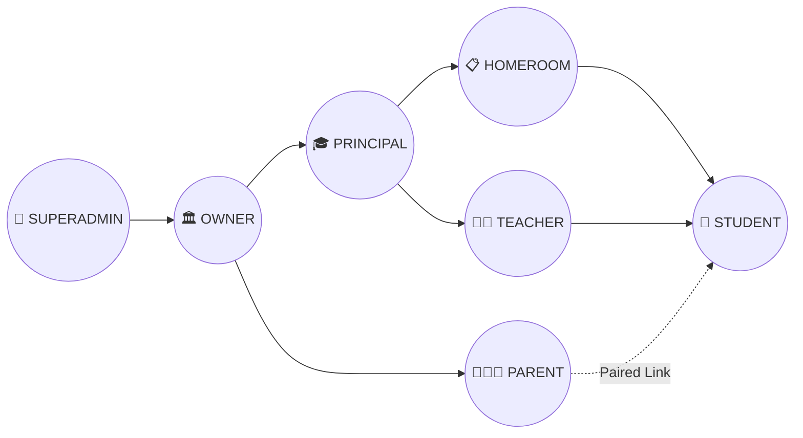
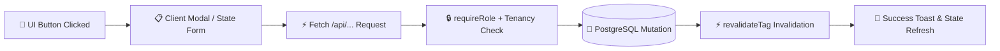

# 🧠 LUCY OS — Master Architectural Brain & System Blueprint

> **Platform**: LUCY Education OS (`Veloura-re/LUCY--re-nw`)  
> **Classification**: All-in-One Autonomous School Operating System  
> **Core Engine**: Next.js 16 (App Router + Turbopack) • Prisma ORM • PostgreSQL • Supabase Auth • TailwindCSS + Framer Motion (Backlit UI)  
> **Scale**: Built for 1,000,000+ Concurrent Students & Multi-Tenant Multi-School Ecosystems

---

## 🗺️ High-Level Architectural Topology

```mermaid
graph TD
    User([🌐 Clients: Web / Mobile / Tablet]) --> Edge[🛡️ Next.js 16 Edge Middleware]
    Edge --> AuthGate{Supabase SSR Auth Gate}
    AuthGate -->|Valid Token| AppRouter[⚡ App Router Server Components & API Routes]
    AuthGate -->|Invalid / Expired| LoginRedirect[/login]
    
    AppRouter --> SecurityLayer[🔒 lib/security.ts: Role & School Tenancy Enforcement]
    SecurityLayer --> CacheLayer[(⚡ Next.js Tagged Cache & Hyperdrive)]
    SecurityLayer --> ORMLayer[🐘 Prisma ORM / pg connection pool]
    
    ORMLayer --> Postgres[(🗄️ PostgreSQL Database)]
    
    subgraph "Core Domain Engines"
        AppRouter --> AcademicEngine[📚 Academic Engine: Marklists, Exams, Terms]
        AppRouter --> FinanceEngine[💳 Financial Ledger: Fees, Invoices, Payroll]
        AppRouter --> GovernanceEngine[🏛️ Director Governance: ActionRequests]
        AppRouter --> AttendanceEngine[🕒 Attendance & Absence Excuse Sync]
        AppRouter --> CommunicationEngine[💬 Real-Time Messaging & Family Portal]
    end
```

---

## 👥 1. User Roles & RBAC Permission Matrix



| Role | Scope | Key Capabilities | Restricted Actions |
| :--- | :--- | :--- | :--- |
| **`SUPERADMIN`** | Platform-Wide | Global school provisioning, billing receipt approvals, system logs, dev-resets. | Cannot fabricate academic marks without audit trace. |
| **`OWNER`** | Single School | Full financial ledgers, approve destructive actions (`ActionRequest`), staff hiring/firing, school settings. | Cannot inspect other tenant databases (isolated by `schoolId`). |
| **`PRINCIPAL`** | Single School | Manage classes, timetable auto-generation, oversee teachers/marklists, approve absence requests. | Destructive actions (deleting teachers/students) require **Owner Approval**. |
| **`TEACHER`** | Class/Subject | Create exams, input marklist entries, mark attendance, generate lesson plans. | Cannot edit finalized/locked exams or view school payroll. |
| **`HOMEROOM`** | Assigned Class | Oversee class attendance, student report cards, aggregate term marklists. | Cannot modify global school fee structures. |
| **`PARENT`** | Linked Children | View grades, attendance history, pay tuition invoices, submit absence notes. | Strictly isolated to verified `ParentStudentLink` IDs. |
| **`STUDENT`** | Self Profile | View assignments, sit for online exams, view report cards, check timetable. | Read-only permissions on grades and attendance. |
| **`ACCOUNTANT`** | Single School | Fees, invoices, expenses, payment checks, payroll (`FINANCE_ROLES`). Invited by a director. | Cannot manage the school's LUCY subscription or open student records. |
| **`RECORDER`** | Single School | Create and edit students, parents and classes (`RECORDS_ROLES`). Invited by a director. | Cannot delete records or see finance. |

---

## 🗄️ 2. Core Database Schema & Entity Relationships

```mermaid
erDiagram
    School ||--o{ User : employs
    School ||--o{ Student : enrolls
    School ||--o{ Grade : defines
    School ||--o{ AcademicTerm : organizes
    School ||--o{ FeeStructure : provisions
    School ||--o{ ActionRequest : audits
    
    Grade ||--o{ Class : divides
    Class ||--o{ Student : contains
    Class ||--o{ MarklistConfig : structures
    Class ||--o{ TimetablePeriod : schedules
    
    Student ||--o{ GradeRecord : earns
    Student ||--o{ AttendanceRecord : logs
    Student ||--o{ Invoice : receives
    Student ||--o{ ParentStudentLink : binds
    
    User ||--o{ ParentStudentLink : parents
    User ||--o{ GradeRecord : grades
    
    Exam ||--o{ GradeRecord : evaluates
    AcademicTerm ||--o{ Exam : bounds
    AcademicTerm ||--o{ MarklistConfig : bounds
    
    Invoice ||--o{ Payment : settles
    Invoice ||--o{ InvoiceItem : itemizes
```

### 🔑 Critical Indexed Models for 1M Scale

1. **`Student` Index Architecture**:
   - `@@index([schoolId, classId])` — Fast class roster retrieval.
   - `@@index([schoolId, studentCode])` — Instant unique badge lookup.
   - `@@index([schoolId, lastName, firstName])` — Paginated directory sorting.
   - `@@index([schoolId, enrollmentStatus])` — Real-time active enrollment filters.

2. **`GradeRecord` Index Architecture**:
   - `@@unique([studentId, examId])` — Zero duplicate submissions per exam.
   - `@@index([studentId, subjectId])` — Instant student GPA rollups.
   - `@@index([examId, score])` — Fast percentile and ranking distributions.

3. **`Payment` Ledger Index Architecture**:
   - `@@index([invoiceId])` — Fast reconciliation against parent invoices.
   - `@@index([status, createdAt])` — Ledger exports & cashier reconciliation.
   - `@@index([reference])` — Webhook gateway lookup (Stripe / Chapa).

4. **`AuditLog` Telemetry Architecture**:
   - `@@index([schoolId, createdAt])` — Sub-second director timeline search.

---

## 🖥️ 3. Full UI Pages & Portal Map

### 👑 SuperAdmin Portal (`/admin/*`)
| Page Route | Access Level | Description & UI Components |
| :--- | :--- | :--- |
| `/admin/dashboard` | `SUPERADMIN` | High-level platform health, total institutions, active students, aggregate revenue telemetry. |
| `/admin/schools` | `SUPERADMIN` | Multi-school directory, tenant provisioning, suspend/activate school switches. |
| `/admin/billing` | `SUPERADMIN` | Platform fee receipts, pending subscription approvals, tier assignments. |
| `/admin/security` | `SUPERADMIN` | Live security telemetry, brute-force rate-limit counters, IP ban controls. |
| `/admin/logs` | `SUPERADMIN` | Unified platform error logs (`ErrorLog`), UI crash dumps, audit timeline. |
| `/admin/requests` | `SUPERADMIN` | Institutional onboarding applications and demo inquiries. |

---

### 🏛️ Director & School Owner Portal (`/dashboard/director/*` & `/dashboard/finance/*`)
| Page Route | Access Level | Description & UI Components |
| :--- | :--- | :--- |
| `/dashboard` | `OWNER`, `PRINCIPAL` | Institutional command center, student/teacher counts, attendance rate, quick action launchpad. |
| `/dashboard/finance` | `OWNER` | Executive financial overview, collected tuition vs pending balances, revenue projection. |
| `/dashboard/finance/revenue` | `OWNER` | Cashflow telemetry, payment gateway reconciliation, income vs expenses breakdown. |
| `/dashboard/finance/students` | `OWNER`, `PRINCIPAL` | Student financial dossiers, outstanding invoice tracking, payment receipt modal. |
| `/dashboard/finance/payroll` | `OWNER` | Staff payroll calculations, salary disbursements, tax/deduction adjustments. |
| `/dashboard/operating-costs` | `OWNER` | Institutional operational expenditure logging (utilities, maintenance, supplies). |
| `/dashboard/approvals` | `OWNER` | Cryptographic approval queue for high-risk action requests submitted by principals. |
| `/dashboard/director/attendance` | `OWNER`, `PRINCIPAL` | School-wide staff and student attendance overviews, department compliance heatmaps. |
| `/dashboard/director/marklist` | `OWNER`, `PRINCIPAL` | Institutional academic marklist monitoring, grade publishing, class rank summaries. |
| `/dashboard/director/marklist/create` | `OWNER`, `PRINCIPAL` | Centralized multi-subject marklist initialization wizard. |

---

### 🎓 Principal & Administration Portal (`/dashboard/*`)
| Page Route | Access Level | Description & UI Components |
| :--- | :--- | :--- |
| `/dashboard/students` | `OWNER`, `PRINCIPAL`, `HOMEROOM` | Full student directory, enrollment modal, class filters, bulk CSV import. |
| `/dashboard/students/[studentId]` | `OWNER`, `PRINCIPAL`, `TEACHER` | Student 360 profile, academic history, remarks, attendance timeline, parent links. |
| `/dashboard/teachers` | `OWNER`, `PRINCIPAL` | Faculty roster, invite teacher modal, subject assignments, workload distribution. |
| `/dashboard/teachers/[id]` | `OWNER`, `PRINCIPAL` | Teacher profile, assigned classes, attendance track record, performance remarks. |
| `/dashboard/classes` | `OWNER`, `PRINCIPAL` | Class & Grade hierarchy manager, room allocation, class capacity indicators. |
| `/dashboard/timetable` | `OWNER`, `PRINCIPAL` | Conflict-free timetable engine, period allocation grid, AI auto-scheduler. |
| `/dashboard/authorizations` | `OWNER`, `PRINCIPAL` | Parent absence authorization approval inbox with 1-click retroactive excuse sync. |
| `/dashboard/attendance/settings` | `OWNER`, `PRINCIPAL` | School attendance rules, late cutoff times, auto-marking policies. |
| `/dashboard/events` | `OWNER`, `PRINCIPAL`, `TEACHER` | School calendar, term milestones, exam schedules, institutional holidays. |
| `/dashboard/books` | `OWNER`, `PRINCIPAL`, `TEACHER` | Curriculum library, textbook units, digital book upload, student checkout tracking. |
| `/dashboard/reports` | `OWNER`, `PRINCIPAL` | Institutional analytics, class GPA rankings, report card batch generation. |
| `/dashboard/reports/attendance` | `OWNER`, `PRINCIPAL` | Monthly attendance audit exports, chronic absenteeism flags. |
| `/dashboard/settings` | `OWNER`, `PRINCIPAL` | School profile, logo upload, branding theme, active Academic Term switcher. |
| `/dashboard/settings/data` | `OWNER` | Database backup export (JSON/SQL), disaster recovery snapshots. |

---

### 👨‍🏫 Teacher & Faculty Portal (`/dashboard/teacher/*`)
| Page Route | Access Level | Description & UI Components |
| :--- | :--- | :--- |
| `/dashboard/teacher/exams` | `TEACHER`, `HOMEROOM` | Teacher exam library, draft/published filters, create exam wizard. |
| `/dashboard/teacher/exams/create` | `TEACHER` | AI exam question generator, manual question builder, rubric editor. |
| `/dashboard/teacher/exams/[id]/editor` | `TEACHER` | Interactive exam editor, question weighting, time limits, lockdown toggles. |
| `/dashboard/teacher/gradebook/[examId]` | `TEACHER` | Real-time digital gradebook, AI feedback generator, bulk score adjustments. |
| `/dashboard/teacher/attendance` | `TEACHER`, `HOMEROOM` | Daily roll-call attendance sheet, 1-tap Present/Absent/Late markers, clock-in button. |
| `/dashboard/teacher/assignments` | `TEACHER` | Assignment manager, homework posting, submission grading inbox. |
| `/dashboard/teacher/lessons` | `TEACHER` | Daily lesson plan repository, curriculum alignment, syllabus tracker. |
| `/dashboard/teacher/schedule` | `TEACHER` | Personal teacher period timetable, upcoming class reminders. |
| `/dashboard/marklist` | `TEACHER`, `HOMEROOM` | Dynamic marklist spreadsheet view, column weight configurator, sync to exams. |
| `/dashboard/marklist/[id]` | `TEACHER`, `HOMEROOM` | Fullscreen marklist matrix editor with live GPA and percentage computations. |

---

### 👨‍👩‍👧 Parent Portal (`/dashboard/parent/*`)
| Page Route | Access Level | Description & UI Components |
| :--- | :--- | :--- |
| `/dashboard/parent` | `PARENT` | Multi-child switcher, daily attendance pulse, live GPA badges, fee balance alerts. |
| `/dashboard/parent/authorizations` | `PARENT` | Submit absence request modal, uploaded doctor note preview, live approval tracker. |
| `/dashboard/parent/homework` | `PARENT` | Child homework and assignment tracker with due date countdowns. |

---

### 🎒 Student Portal (`/dashboard/student/*`)
| Page Route | Access Level | Description & UI Components |
| :--- | :--- | :--- |
| `/dashboard/student` | `STUDENT` | Student dashboard, daily timetable cards, upcoming tests, recent grades. |
| `/dashboard/student/assignments` | `STUDENT` | Active assignments, homework submission upload modal, teacher feedback. |
| `/dashboard/student/attendance` | `STUDENT` | Personal attendance calendar, percentage score, excuse records. |
| `/dashboard/student/exams` | `STUDENT` | Available online test portal, countdown timers, take exam launchpad. |
| `/dashboard/student/grades` | `STUDENT` | Subject-wise gradebook breakdown, GPA rankings, term report card view. |
| `/dashboard/student/lessons` | `STUDENT` | Class syllabus, study material downloads, lesson notes. |
| `/dashboard/student/timetable` | `STUDENT` | Interactive weekly timetable grid with classroom and teacher tags. |
| `/dashboard/student/profile` | `STUDENT` | Student ID card, badge QR code, enrollment details. |

---

### 🌐 Public & Auth Routes
| Page Route | Purpose | Key Connections |
| :--- | :--- | :--- |
| `/` | Institutional Landing Page | Hero, platform features, Backlit dark aesthetic, CTA links. |
| `/login` | Central Auth Login | Supabase Auth login, role-based redirector. |
| `/register` | School Registration Portal | Create new institution, provision Owner account. |
| `/register/admin` | Admin Invitation Signup | Staff registration via signed invite tokens. |
| `/register/parent` | Parent Self-Registration | Direct parent account creation. |
| `/register/student` | Student Account Activation | Student registration via school code. |
| `/forgot-password` | Password Recovery | Reset email dispatcher. |
| `/reset-password` | Password Reset Form | Token-verified password updater. |
| `/invite/[token]` | Staff/Teacher Invite Onboarding | Verify cryptographic invite token, create user profile. |
| `/verify/student/[studentId]` | Public Student Credential Verification | QR badge verification for security and official credentials. |
| `/docs` | Platform Documentation | Institutional user guides & technical docs. |
| `/deck` | Executive Presentation | Institutional pitch presentation. |

---

## ⚡ 4. Complete API Directory & Connection Matrix

### 🔐 Auth & Identity APIs (`/api/auth/*` & `/api/user/*`)
| Method | Endpoint | Role Guard | DB Models | Invalidation / Action |
| :--- | :--- | :--- | :--- | :--- |
| `POST` | `/api/auth/login` | Public | `User`, `AuthAuditLog`, `AuthRateLimit` | Rate limited login, issues Supabase SSR session. |
| `POST` | `/api/auth/register-admin` | Public / Token | `User`, `School` | Provisions new School Owner and tenant DB records. |
| `POST` | `/api/auth/register/student` | Public | `Student`, `User` | Links student user account to existing Student profile. |
| `POST` | `/api/auth/forgot-password` | Public | `User` | Dispatches reset password email. |
| `PATCH` | `/api/user/password` | Authenticated | `User` | Updates user password in Supabase & Prisma. |
| `GET`/`PATCH` | `/api/user/settings` | Authenticated | `User` | User preferences, theme, notification settings. |

---

### 📚 Academic & Marklist APIs (`/api/marklist/*` & `/api/school/marklists/*`)
| Method | Endpoint | Role Guard | DB Models | Invalidation / Action |
| :--- | :--- | :--- | :--- | :--- |
| `GET` | `/api/marklist/config` | Staff (`TEACHER`+) | `MarklistConfig`, `Class` | Fetches column structure scoped by `user.schoolId`. |
| `POST` | `/api/marklist/config` | Staff (`TEACHER`+) | `MarklistConfig`, `MarklistColumn` | Upserts column weights, links to `AcademicTerm`. |
| `POST` | `/api/marklist/entry` | Staff (`TEACHER`+) | `MarklistEntry` | Autosaves raw student row scores in real-time. |
| `POST` | `/api/marklist/sync` | Staff (`TEACHER`+) | `GradeRecord`, `Exam` | Scaled gradebook sync; triggers `revalidateTag(GRADES)`. |
| `GET` | `/api/director/marklists` | `OWNER`, `PRINCIPAL` | `MarklistConfig`, `Grade` | Global marklist compliance overview. |

---

### 💳 Financial Ledger APIs (`/api/school/finance/*` & `/api/school/billing/*`)
| Method | Endpoint | Role Guard | DB Models | Invalidation / Action |
| :--- | :--- | :--- | :--- | :--- |
| `GET`/`POST` | `/api/school/finance/fees` | `OWNER`, `PRINCIPAL` | `FeeStructure`, `Grade` | Defines grade-level tuition, lab, and transport fees. |
| `GET`/`POST` | `/api/school/finance/invoices` | `OWNER`, `PRINCIPAL` | `Invoice`, `InvoiceItem` | Provisions student fee invoices. |
| `POST` | `/api/school/finance/pay` | `OWNER`, `PRINCIPAL`, `PARENT` | `Payment`, `Invoice` | Records payment transaction, updates invoice status. |
| `GET` | `/api/school/finance/payroll` | `OWNER` | `User`, `Payment` | Computes staff payroll balances and disbursements. |
| `POST` | `/api/school/billing/receipt` | `OWNER`, `SUPERADMIN` | `BillingReceipt` | Uploads offline bank deposit slip for review. |
| `POST` | `/api/webhooks/stripe` | Webhook Secret | `Payment`, `Invoice` | International payment fulfillment webhook. |
| `POST` | `/api/webhooks/chapa` | Webhook Secret | `Payment`, `Invoice` | Ethiopian Telebirr/CBE payment fulfillment webhook. |

---

### 🕒 Attendance & Excuse APIs (`/api/school/attendance/*` & `/api/school/authorizations/*`)
| Method | Endpoint | Role Guard | DB Models | Invalidation / Action |
| :--- | :--- | :--- | :--- | :--- |
| `GET`/`POST` | `/api/school/attendance` | `TEACHER`, `HOMEROOM`+ | `AttendanceRecord` | Records daily roll-call attendance. |
| `POST` | `/api/parent/authorizations` | `PARENT` | `AbsenceAuthorization` | Submits absence note with date ranges and notes. |
| `PATCH` | `/api/school/authorizations` | `PRINCIPAL`, `OWNER` | `AbsenceAuthorization`, `AttendanceRecord` | Approves absence & retroactively syncs records to `EXCUSED`. |
| `POST` | `/api/teacher/attendance/clock-in` | `TEACHER` | `StaffAttendance` | Logs faculty clock-in with geo/timestamp verify. |

---

### 🏛️ Governance & Action Approval APIs (`/api/school/approvals/*`)
| Method | Endpoint | Role Guard | DB Models | Invalidation / Action |
| :--- | :--- | :--- | :--- | :--- |
| `GET` | `/api/school/approvals` | `OWNER` | `ActionRequest`, `User` | Pending high-risk deletion queues. |
| `POST` | `/api/school/approvals/resolve` | `OWNER` | `ActionRequest` + Target | Approves/Rejects destructive action requests. |

---

### 👨‍👩‍👧 Family & Student APIs (`/api/parent/*` & `/api/student/*`)
| Method | Endpoint | Role Guard | DB Models | Invalidation / Action |
| :--- | :--- | :--- | :--- | :--- |
| `GET` | `/api/parent/children` | `PARENT` | `Student`, `ParentStudentLink` | Retrieves all linked children profiles. |
| `POST` | `/api/parent/link-student` | `PARENT` | `Student`, `ParentStudentLink` | Rates-limited student badge code pairing. |
| `GET` | `/api/student/dashboard` | `STUDENT` | `Student`, `Class`, `Exam` | Aggregated student timetable, grades, and tasks. |
| `POST` | `/api/student/exams/submit` | `STUDENT` | `ExamAttempt`, `GradeRecord` | Submits online exam answers for automatic scoring. |

---

## 🎯 5. Master Interactive Button & Action Triggers Map

This table maps every primary button in the platform to its exact UI component, trigger action, backend API call, database mutation, and cache invalidation.



| # | Portal / Page | UI Button Label | Client Action & Form Trigger | API Endpoint Called | Database Mutation / Effect | Cache Tag Invalidated |
|---|---|---|---|---|---|---|
| **1** | Landing Page (`/`) | **"Get Started"** | Redirects to `/register` | — | Navigates to institution provisioning flow. | — |
| **2** | Landing Page (`/`) | **"Sign In"** | Opens Auth Modal / Navigates to `/login` | `POST /api/auth/login` | Creates Supabase auth session cookie. | — |
| **3** | Student Directory (`/dashboard/students`) | **"Enroll Student"** | Opens `<CreateStudentModal>` | `POST /api/school/students` | `prisma.student.create`, provisions fee invoices, auto-links parent. | `school:{id}:students` |
| **4** | Student Directory (`/dashboard/students`) | **"Delete Student"** | Principal: Opens `<DeleteRequestModal>`<br>Owner: Instant Delete | `DELETE /api/school/students` | Principal: `prisma.actionRequest.create`<br>Owner: `prisma.student.delete` | `school:{id}:students` |
| **5** | Marklist Grid (`/dashboard/marklist/[id]`) | **"Save Column Layout"** | Configures column weights (Quiz, Midterm, Final) | `POST /api/marklist/config` | `prisma.marklistConfig.upsert`, reconciles `marklistColumn` IDs. | `school:{id}:grades` |
| **6** | Marklist Grid (`/dashboard/marklist/[id]`) | **"Sync to Gradebook"** | Verifies exam unlock, scales scores to maxMarks | `POST /api/marklist/sync` | `prisma.gradeRecord.upsert` inside atomic transaction. | `school:{id}:grades` |
| **7** | Absence Inbox (`/dashboard/authorizations`) | **"Approve Absence"** | Sets authorization status to `APPROVED` | `PATCH /api/school/authorizations` | `prisma.absenceAuthorization.update`, retroactively sets `AttendanceRecord` to `EXCUSED`. | `school:{id}:attendance` |
| **8** | Teacher Roll-Call (`/dashboard/teacher/attendance`) | **"Submit Attendance"** | Batch submits class present/absent/late marks | `POST /api/school/attendance` | `prisma.attendanceRecord.createMany` | `school:{id}:attendance` |
| **9** | Teacher Exam Editor (`/dashboard/teacher/exams/create`) | **"AI Generate Exam"** | Sends prompt/curriculum topic to AI extractor | `POST /api/teacher/exams/extract` | Calls Gemini API, parses structured question JSON. | — |
| **10** | Teacher Exam Editor (`/dashboard/teacher/exams/[id]/editor`) | **"Publish Exam"** | Sets `isPublished: true`, locks questions | `PATCH /api/teacher/exams/[id]` | `prisma.exam.update({ isPublished: true })` | `school:{id}:grades` |
| **11** | Teacher Exam Editor (`/dashboard/teacher/exams/[id]/editor`) | **"Seal / Lock Exam"** | Finalizes all grading, blocks future edits | `PATCH /api/teacher/exams/[id]` | `prisma.exam.update({ isLocked: true })` | `school:{id}:grades` |
| **12** | Timetable Manager (`/dashboard/timetable`) | **"Auto-Generate Timetable"** | Runs conflict-free period allocation algorithm | `POST /api/school/timetable/auto-generate` | `prisma.timetablePeriod.deleteMany` + `createMany` | `school:{id}:classes` |
| **13** | Action Approvals (`/dashboard/approvals`) | **"Approve Request"** | Owner authorizes destructive staff action | `POST /api/school/approvals/resolve` | Executes target payload (`DELETE_TEACHER`, etc.) & marks `APPROVED`. | Target Entity Tag |
| **14** | Fee Structures (`/dashboard/finance`) | **"Create Fee Structure"** | Opens `<CreateFeeModal>` (Tuition, Transport) | `POST /api/school/finance/fees` | `prisma.feeStructure.create` | `school:{id}:finance` |
| **15** | Invoice Ledger (`/dashboard/finance/students`) | **"Record Cash Payment"** | Opens `<RecordPaymentModal>`, enters receipt # | `POST /api/school/finance/pay` | `prisma.payment.create`, updates `Invoice.status` to `PAID`. | `school:{id}:finance` |
| **16** | Parent Portal (`/dashboard/parent`) | **"Link Child via Code"** | Opens `<PairStudentModal>`, enters `ST-XXX` | `POST /api/parent/link-student` | `prisma.parentStudentLink.create` | `school:{id}:students` |
| **17** | Parent Portal (`/dashboard/parent/authorizations`) | **"Submit Excuse Note"** | Opens `<NewAuthorizationModal>`, attaches note | `POST /api/parent/authorizations` | `prisma.absenceAuthorization.create` | `school:{id}:attendance` |
| **18** | Student Exam Portal (`/dashboard/student/exams`) | **"Start Exam"** | Starts test countdown timer | `POST /api/student/exams/start` | `prisma.examAttempt.create({ startedAt: now() })` | — |
| **19** | Student Exam Portal (`/dashboard/student/exams/[id]`) | **"Submit Exam Answers"** | Submits student responses for automatic score | `POST /api/student/exams/submit` | Computes score, saves `GradeRecord` with `status: SUBMITTED`. | `school:{id}:grades` |
| **20** | School Settings (`/dashboard/settings`) | **"Switch Active Term"** | Selects active academic term (e.g. Semester 2) | `PATCH /api/school/terms` | Updates `AcademicTerm.isActive = true`, unsets previous active. | `school:{id}:classes` |
| **21** | Data Center (`/dashboard/settings/data`) | **"Export Database Backup"** | Generates encrypted institutional dump | `POST /api/school/backups/generate` | Serializes tenant records to JSON/SQL snapshot. | — |
| **22** | Staff Portal (`/dashboard`) | **"Scan Student ID"** | Opens `<StudentQRScannerModal>` to scan QR badges | `POST /api/school/students/scan` | Strict `schoolId` match check, returns verified profile and logs audit entry. | `school:{id}:students` |

---

## 🛡️ 6. The 17 Technical Defense Sentinels

```
┌────┬─────────────────────────────┬────────────────────────────────────────────────────────┐
│ #  │ Sentinel Gate               │ Enforced Architecture                                  │
├────┼─────────────────────────────┼────────────────────────────────────────────────────────┤
│ 01 │ Multi-Tenant & IDOR         │ All queries scoped by session user.schoolId            │
│ 02 │ Cold-Start Sentinel         │ Zero blocking I/O, static ES imports, fast edge boot  │
│ 03 │ Schema Contract             │ 100% type matching with schema.prisma                  │
│ 04 │ Type Safety & Zod           │ Strict Zod schemas sanitize all incoming payloads      │
│ 05 │ Observability Logger        │ Audit logging on all critical mutations (AuditLog)     │
│ 06 │ Cache Coherency             │ Granular Next.js revalidateTag on mutations            │
│ 07 │ Financial Ledger            │ Composite indexes, atomic transactions, no split-loss  │
│ 08 │ RBAC Enforcer               │ requireRole() guard on every sensitive route           │
│ 09 │ N+1 Query Terminator        │ Batch Prisma includes, avoid loops in transactions     │
│ 10 │ UI Resilience               │ Graceful handleApiError and toast notifications        │
│ 11 │ Realtime Moderator          │ Token verification on chat & message upload            │
│ 12 │ Exam & AI Firewall          │ isLocked checks prevent mark changes post-finalization │
│ 13 │ Attendance Solver           │ Atomic absence approval excusal synchronization        │
│ 14 │ Jest Test Gate              │ Regression test suites verified passing                │
│ 15 │ Storage Sentinel            │ Signed Supabase URLs, MIME type verification           │
│ 16 │ Comms Guardian              │ Rate limiting on outbound emails and SMS alerts        │
│ 17 │ Release Gatekeeper          │ Zero TypeScript lint errors on production build        │
└────┴─────────────────────────────┴────────────────────────────────────────────────────────┘
```

---

## ⚡ 7. Tagged Cache Coherency Matrix

| Cache Tag Constant | Tag Signature | Invalidation Trigger |
| :--- | :--- | :--- |
| `CACHE_TAGS.STUDENTS` | `school:{id}:students` | Student created, updated, or deleted. |
| `CACHE_TAGS.TEACHERS` | `school:{id}:teachers` | Teacher invited, modified, or archived. |
| `CACHE_TAGS.CLASSES` | `school:{id}:classes` | Class/grade structure modified. |
| `CACHE_TAGS.GRADES` | `school:{id}:grades` | Marklist synced or exam graded. |
| `CACHE_TAGS.SCHOOL_ATTENDANCE` | `school:{id}:attendance` | Absence authorized or daily clock-in recorded. |
| `CACHE_TAGS.FINANCE` | `school:{id}:finance` | Invoice paid, fee created, or receipt verified. |

---

## 📂 8. Core Repository Map for Obsidian Links

- 🏛️ **Schema Definition**: [[prisma/schema.prisma]]
- 🛡️ **Security Guards**: [[lib/security.ts]]
- 📊 **Audit Logger**: [[lib/audit.ts]]
- ⚡ **Cache Tags**: [[lib/cache.ts]]
- 📚 **Marklist Route**: [[app/api/marklist/sync/route.ts]]
- 🕒 **Attendance Route**: [[app/api/school/authorizations/route.ts]]
- 💳 **Finance Route**: [[app/api/school/finance/invoices/route.ts]]
- 👨‍👩‍👧 **Parent Route**: [[app/api/school/students/route.ts]]
- 🌐 **Landing Page**: [[app/page.tsx]]

---
*Generated by the 23-Subagent Supreme Council • LUCY Education OS Brain v1.0*
