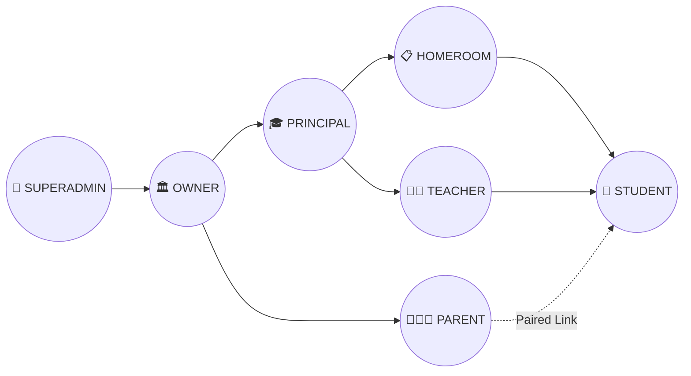
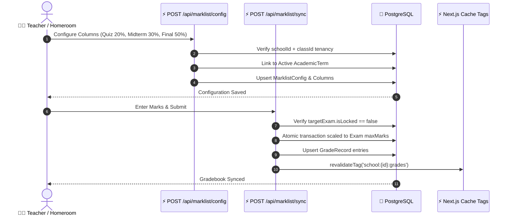
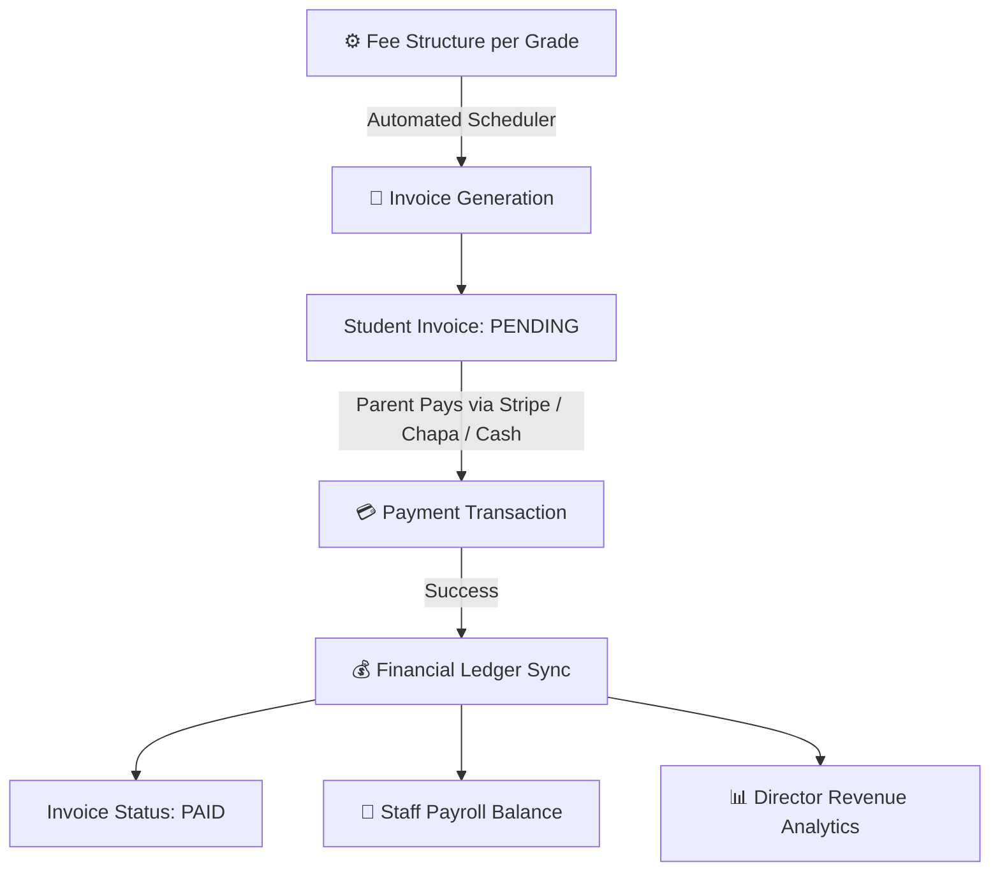
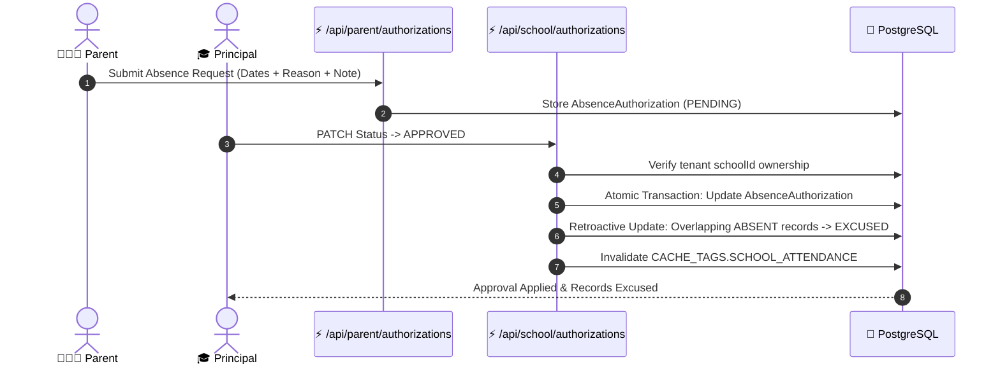
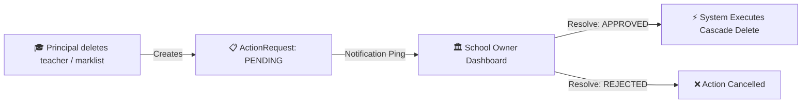

# 🧠 LUCY OS — Master Architectural Brain & System Blueprint

> **Platform**: LUCY Education OS (`Veloura-re/LUCY--re-nw`)  
> **Classification**: All-in-One Autonomous School Operating System  
> **Core Engine**: Next.js 16 (App Router + Turbopack) • Prisma ORM • PostgreSQL • Supabase Auth • TailwindCSS + Framer Motion (Backlit UI)  
> **Scale**: Built for 1,000,000+ Concurrent Students & Multi-Tenant Multi-School Ecosystems

---

## 🗺️ High-Level Architectural Topology

```mermaid
graph TD
    User([🌐 Clients: Web / Mobile / Tablet]) --> Edge[🛡️ Next.js 16 Edge Middleware]
    Edge --> AuthGate{Supabase SSR Auth Gate}
    AuthGate -->|Valid Token| AppRouter[⚡ App Router Server Components & API Routes]
    AuthGate -->|Invalid / Expired| LoginRedirect[/login]
    
    AppRouter --> SecurityLayer[🔒 lib/security.ts: Role & School Tenancy Enforcement]
    SecurityLayer --> CacheLayer[(⚡ Next.js Tagged Cache & Hyperdrive)]
    SecurityLayer --> ORMLayer[🐘 Prisma ORM / pg connection pool]
    
    ORMLayer --> Postgres[(🗄️ PostgreSQL Database)]
    
    subgraph "Core Domain Engines"
        AppRouter --> AcademicEngine[📚 Academic Engine: Marklists, Exams, Terms]
        AppRouter --> FinanceEngine[💳 Financial Ledger: Fees, Invoices, Payroll]
        AppRouter --> GovernanceEngine[🏛️ Director Governance: ActionRequests]
        AppRouter --> AttendanceEngine[🕒 Attendance & Absence Excuse Sync]
        AppRouter --> CommunicationEngine[💬 Real-Time Messaging & Family Portal]
    end
```

---

## 👥 1. User Roles & RBAC Permission Matrix



| Role | Scope | Key Capabilities | Restricted Actions |
| :--- | :--- | :--- | :--- |
| **`SUPERADMIN`** | Platform-Wide | Global school provisioning, billing receipt approvals, system logs, dev-resets. | Cannot fabricate academic marks without audit trace. |
| **`OWNER`** | Single School | Full financial ledgers, approve destructive actions (`ActionRequest`), staff hiring/firing, school settings. | Cannot inspect other tenant databases (isolated by `schoolId`). |
| **`PRINCIPAL`** | Single School | Manage classes, timetable auto-generation, oversee teachers/marklists, approve absence requests. | Destructive actions (deleting teachers/students) require **Owner Approval**. |
| **`TEACHER`** | Class/Subject | Create exams, input marklist entries, mark attendance, generate lesson plans. | Cannot edit finalized/locked exams or view school payroll. |
| **`HOMEROOM`** | Assigned Class | Oversee class attendance, student report cards, aggregate term marklists. | Cannot modify global school fee structures. |
| **`PARENT`** | Linked Children | View grades, attendance history, pay tuition invoices, submit absence notes. | Strictly isolated to verified `ParentStudentLink` IDs. |
| **`STUDENT`** | Self Profile | View assignments, sit for online exams, view report cards, check timetable. | Read-only permissions on grades and attendance. |

---

## 🗄️ 2. Core Database Schema & Entity Relationships

```mermaid
erDiagram
    School ||--o{ User : employs
    School ||--o{ Student : enrolls
    School ||--o{ Grade : defines
    School ||--o{ AcademicTerm : organizes
    School ||--o{ FeeStructure : provisions
    School ||--o{ ActionRequest : audits
    
    Grade ||--o{ Class : divides
    Class ||--o{ Student : contains
    Class ||--o{ MarklistConfig : structures
    Class ||--o{ TimetablePeriod : schedules
    
    Student ||--o{ GradeRecord : earns
    Student ||--o{ AttendanceRecord : logs
    Student ||--o{ Invoice : receives
    Student ||--o{ ParentStudentLink : binds
    
    User ||--o{ ParentStudentLink : parents
    User ||--o{ GradeRecord : grades
    
    Exam ||--o{ GradeRecord : evaluates
    AcademicTerm ||--o{ Exam : bounds
    AcademicTerm ||--o{ MarklistConfig : bounds
    
    Invoice ||--o{ Payment : settles
    Invoice ||--o{ InvoiceItem : itemizes
```

### 🔑 Critical Indexed Models for 1M Scale

> [!NOTE]
> All tables feature direct or composite tenant indexes preventing table-wide sequential heap scans.

1. **`Student` Index Architecture**:
   - `@@index([schoolId, classId])` — Fast class roster retrieval.
   - `@@index([schoolId, studentCode])` — Instant unique badge lookup.
   - `@@index([schoolId, lastName, firstName])` — Paginated directory sorting.
   - `@@index([schoolId, enrollmentStatus])` — Real-time active enrollment filters.

2. **`GradeRecord` Index Architecture**:
   - `@@unique([studentId, examId])` — Zero duplicate submissions per exam.
   - `@@index([studentId, subjectId])` — Instant student GPA rollups.
   - `@@index([examId, score])` — Fast percentile and ranking distributions.

3. **`Payment` Ledger Index Architecture**:
   - `@@index([invoiceId])` — Fast reconciliation against parent invoices.
   - `@@index([status, createdAt])` — Ledger exports & cashier reconciliation.
   - `@@index([reference])` — Webhook gateway lookup (Stripe / Chapa).

4. **`AuditLog` Telemetry Architecture**:
   - `@@index([schoolId, createdAt])` — Sub-second director timeline search.

---

## 📚 3. Academic & Dynamic Marklist Engine

The **Marklist Engine** replaces rigid legacy spreadsheets with dynamic, customizable evaluation grids bounded by Academic Terms.



---

## 💳 4. Financial Engine & Ledger Architecture



### Financial Features
- **Automated Grade Invoicing**: Fees configured on `Grade` (e.g. Tuition, Lab Fees, Transport) auto-provision invoices upon student enrollment.
- **Multi-Gateway Support**: Integrated with **Stripe** (International) and **Chapa** (Local Ethiopian Mobile Money/Telebirr).
- **Offline Cash Reconciliation**: Bank slips uploaded via `BillingReceipt` with Principal/Owner verification gates.

---

## 🕒 5. Attendance & Absence Authorization Loop



---

## 🏛️ 6. Director Governance & Action Requests

To prevent malicious or accidental data deletion by staff, destructive actions require **Owner Cryptographic Approval**:



- **Protected Actions**: `DELETE_TEACHER`, `DELETE_STUDENT`, `ARCHIVE_MARKLIST`, `RESET_TIMETABLE`.

---

## 🛡️ 7. The 17 Technical Defense Sentinels

All endpoints and database mutations are validated against the 17 Defense Gates:

```
┌────┬─────────────────────────────┬────────────────────────────────────────────────────────┐
│ #  │ Sentinel Gate               │ Enforced Architecture                                  │
├────┼─────────────────────────────┼────────────────────────────────────────────────────────┤
│ 01 │ Multi-Tenant & IDOR         │ All queries scoped by session user.schoolId            │
│ 02 │ Cold-Start Sentinel         │ Zero blocking I/O, static ES imports, fast edge boot  │
│ 03 │ Schema Contract             │ 100% type matching with schema.prisma                  │
│ 04 │ Type Safety & Zod           │ Strict Zod schemas sanitize all incoming payloads      │
│ 05 │ Observability Logger        │ Audit logging on all critical mutations (AuditLog)     │
│ 06 │ Cache Coherency             │ Granular Next.js revalidateTag on mutations            │
│ 07 │ Financial Ledger            │ Composite indexes, atomic transactions, no split-loss  │
│ 08 │ RBAC Enforcer               │ requireRole() guard on every sensitive route           │
│ 09 │ N+1 Query Terminator        │ Batch Prisma includes, avoid loops in transactions     │
│ 10 │ UI Resilience               │ Graceful handleApiError and toast notifications        │
│ 11 │ Realtime Moderator          │ Token verification on chat & message upload            │
│ 12 │ Exam & AI Firewall          │ isLocked checks prevent mark changes post-finalization │
│ 13 │ Attendance Solver           │ Atomic absence approval excusal synchronization        │
│ 14 │ Jest Test Gate              │ Regression test suites verified passing                │
│ 15 │ Storage Sentinel            │ Signed Supabase URLs, MIME type verification           │
│ 16 │ Comms Guardian              │ Rate limiting on outbound emails and SMS alerts        │
│ 17 │ Release Gatekeeper          │ Zero TypeScript lint errors on production build        │
└────┴─────────────────────────────┴────────────────────────────────────────────────────────┘
```

---

## ⚡ 8. Tagged Cache Coherency Matrix

LUCY OS uses Next.js Tagged Cache revalidation to ensure near-zero database load on read traffic while maintaining instant data updates:

| Cache Tag Constant | Tag Signature | Invalidation Trigger |
| :--- | :--- | :--- |
| `CACHE_TAGS.STUDENTS` | `school:{id}:students` | Student created, updated, or deleted. |
| `CACHE_TAGS.TEACHERS` | `school:{id}:teachers` | Teacher invited, modified, or archived. |
| `CACHE_TAGS.CLASSES` | `school:{id}:classes` | Class/grade structure modified. |
| `CACHE_TAGS.GRADES` | `school:{id}:grades` | Marklist synced or exam graded. |
| `CACHE_TAGS.SCHOOL_ATTENDANCE` | `school:{id}:attendance` | Absence authorized or daily clock-in recorded. |
| `CACHE_TAGS.FINANCE` | `school:{id}:finance` | Invoice paid, fee created, or receipt verified. |

---

## 🌐 9. Internationalization Engine (100+ Languages)

- **Language Registry**: `lib/translations.ts`
- **RTL Support**: Built-in dynamic direction switching (`dir="rtl"`) for Arabic (`ar`), Hebrew (`he`), Urdu (`ur`).
- **African Language Support**: Full dictionary coverage for Amharic (`am`), Oromo (`om`), Tigrinya (`ti`), Swahili (`sw`), Somali (`so`).

---

## 📂 10. Core Repository Map for Obsidian Links

- 🏛️ **Schema Definition**: [[prisma/schema.prisma]]
- 🛡️ **Security Guards**: [[lib/security.ts]]
- 📊 **Audit Logger**: [[lib/audit.ts]]
- ⚡ **Cache Tags**: [[lib/cache.ts]]
- 📚 **Marklist Route**: [[app/api/marklist/sync/route.ts]]
- 🕒 **Attendance Route**: [[app/api/school/authorizations/route.ts]]
- 💳 **Finance Route**: [[app/api/school/finance/invoices/route.ts]]
- 👨‍👩‍👧 **Parent Route**: [[app/api/school/students/route.ts]]
- 🌐 **Landing Page**: [[app/page.tsx]]

---
*Generated by the 23-Subagent Supreme Council • LUCY Education OS Brain v1.0*
